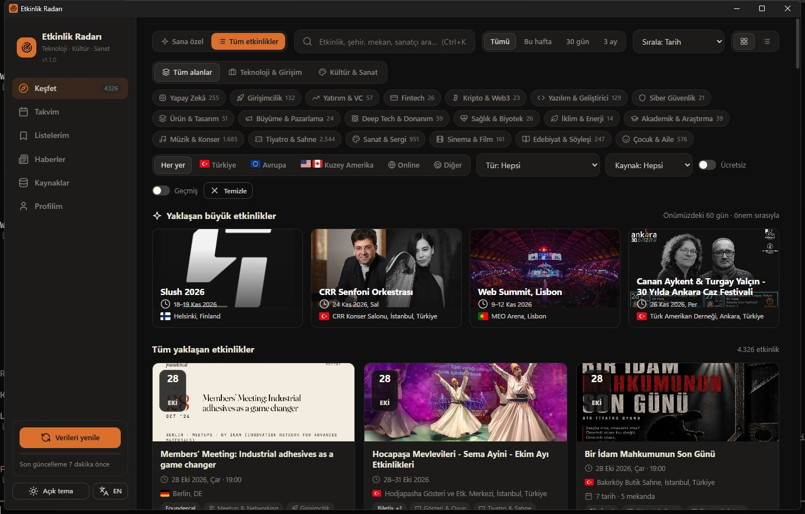
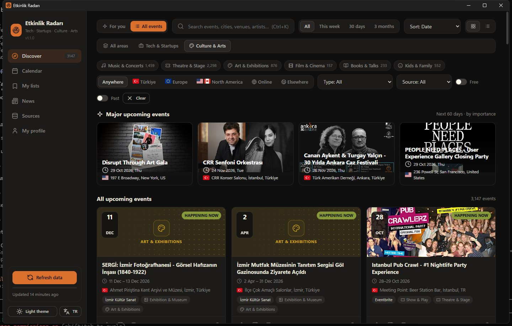
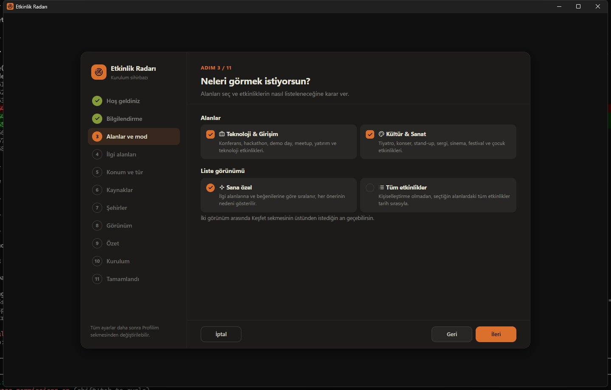
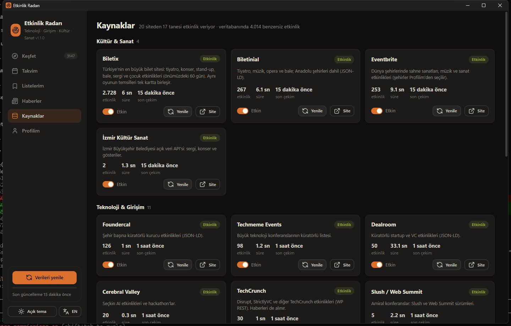
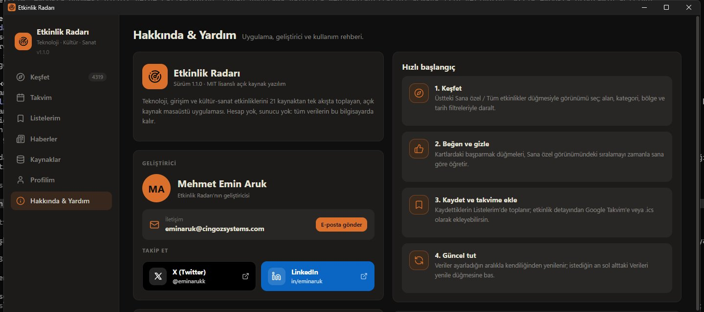

# Etkinlik Radarı

Teknoloji, girişim ve **kültür-sanat** etkinliklerini **21 kaynaktan** toplayan açık kaynak masaüstü uygulaması.
Etkinlikleri ilgi alanlarına ve beğenilerine göre sıralar, istersen kişiselleştirme olmadan hepsini tarih sırasıyla
gösterir. Türkçe ve İngilizce arayüz; Windows, macOS ve Linux.



## İndir

| | |
|---|---|
| **Windows (kolay kurulum)** | [Releases](https://github.com/KULLANICI_ADI/etkinlik-radari/releases/latest) sayfasından **`EtkinlikRadari-<sürüm>-Setup.exe`** dosyasını indir, çift tıkla, sihirbazı izle. Python gerekmez. |
| **Windows / macOS / Linux (kaynak koddan)** | Aşağıdaki [Kaynak koddan kurulum](#kaynak-koddan-kurulum) adımları. |

> Windows SmartScreen "Windows bilgisayarınızı korudu" uyarısı gösterirse **Ek bilgi → Yine de çalıştır**'a tıkla
> (kurulum dosyası dijital olarak imzalı değildir). Kurulum yönetici izni istemez; varsayılan olarak yalnızca
> senin kullanıcı hesabına kurulur. Kaldırmak için: **Ayarlar → Uygulamalar → Etkinlik Radarı → Kaldır**.

## Özellikler

- **Tek akış:** Luma, Biletix, etkinlik.io, Biletinial, Eventbrite, Devpost, Dealroom, TechCrunch, Webrazzi ve
  diğerlerinden ~4.300 etkinlik (Türkiye'de 24 şehirden 3.000'i aşkın kültür-sanat etkinliği); aynı etkinliğin farklı kaynaklardaki kopyaları ve aynı oyunun temsilleri tek kartta birleşir.
- **İki alan:** *Teknoloji & Girişim* (konferans, hackathon, demo day, meetup) ve *Kültür & Sanat* (konser, tiyatro,
  stand-up, opera-bale, sergi, sinema, festival, çocuk etkinlikleri). İstediğin alanı seç ya da ikisini birden izle.
- **İki görünüm:** *Sana özel* (puanlı, gerekçeli öneriler) ve *Tüm etkinlikler* (kişiselleştirmesiz, tarih sıralı tam
  liste). Keşfet sekmesinin üstünden tek tıkla geçilir.
- **Türkçe / English:** Arayüz, kategoriler ve öneri gerekçeleri iki dilde; dil anında değiştirilir.
- **Sana göre sıralama:** Uygunluk puanı, seçtiğin ilgi alanlarından ve beğen / ilgilenmiyorum tepkilerinden öğrenir.
  Her öneride nedenini görürsün ("Türkiye'de", "Yapay Zekâ ilgini çekiyor"…).
- **Filtreler:** Kategori, bölge (ülke bayraklarıyla), tür, kaynak, tarih aralığı, ücretsiz etkinlikler.
- **Takvim ve listeler:** Kaydet, katıldım olarak işaretle, Google Takvim'e veya `.ics` olarak ekle.
- **Ekosistem haberleri:** Türkiye ve dünyadan girişim / yatırım haberleri (Swipeline, Webrazzi, Endeavor, TechCrunch,
  Techmeme, Crunchbase News).
- **Koyu / açık / sistem teması** (Flexoki paleti), vektörel ikonlar.
- **Kurulum sihirbazı:** İlk açılışta adım adım ilgi alanlarını, konumları, kaynakları, şehirleri ve görünümü sorar.
- **Hakkında & Yardım sekmesi:** Hızlı başlangıç rehberi, sık sorulan sorular, geliştirici iletişim bilgileri ve
  bağlantıları.
- Hesap yok, sunucu yok: tüm veriler bilgisayarında kalır.

| Kültür & Sanat (English) | Kurulum sihirbazı | Kaynaklar | Haberler |
|---|---|---|---|
|  |  |  |  |

## Kaynak koddan kurulum

Gerekenler: **Python 3.10 veya üstü** ve internet bağlantısı.

1. Projeyi indir: `git clone https://github.com/KULLANICI_ADI/etkinlik-radari.git`
   (veya GitHub'da **Code → Download ZIP** ile indirip klasörü aç).
2. Klasörün içinde kurulum aracını çalıştır:

   ```bash
   cd etkinlik-radari
   python install.py        # macOS / Linux'ta: python3 install.py
   ```

Kurulum aracı adım adım ilerler:

```
[1/5] Sistem kontrolü         Python sürümü ve işletim sistemi
[2/5] Kurulum klasörü         varsayılanı kabul et veya başka bir klasör yaz
[3/5] Uygulama yükleniyor     ayrı bir sanal ortam (venv) oluşturulur, bağımlılıklar yüklenir
[4/5] Kısayollar              Başlat menüsü / Uygulamalar / uygulama menüsü ve masaüstü
[5/5] Tamamlandı              istersen uygulamayı hemen başlatır
```

Uygulama ilk açıldığında **kurulum sihirbazı** başlar (dil → bilgilendirme → alanlar ve görünüm → ilgi alanları →
konum ve tür → kaynaklar → şehirler → tema → özet → ilk veri indirme → bitti). *Tüm etkinlikler* görünümü seçilirse
ilgi alanı ve konum adımları atlanır. Sihirbazı daha sonra
**Profilim → Kurulum sihirbazını aç** ile tekrar çalıştırabilirsin.

| İşletim sistemi | Varsayılan kurulum klasörü | Kısayollar |
|---|---|---|
| Windows | `%LOCALAPPDATA%\Programs\EtkinlikRadari` | Başlat menüsü + Masaüstü (`.lnk`) |
| macOS | `~/Library/Application Support/EtkinlikRadari/app` | `~/Applications/Etkinlik Radarı.app` + Masaüstü |
| Linux | `~/.local/share/etkinlik-radari/app` | Uygulama menüsü (`.desktop`) + Masaüstü |

Kurulum aracı seçenekleri:

```bash
python install.py --yes            # soru sormadan varsayılanlarla kur
python install.py --dir D:\Apps\ER # başka bir klasöre kur
python install.py --no-shortcuts   # kısayol oluşturma
python install.py --no-launch      # kurulumdan sonra başlatma
python install.py --uninstall      # kaldır (kullanıcı verilerini silmek isteğe bağlı)
```

> Kurulumdan sonra indirdiğin proje klasörünü silebilirsin; uygulama kendi klasöründe çalışır.

### Alternatif: pip ile

```bash
python -m venv .venv
# Windows: .venv\Scripts\activate    macOS/Linux: source .venv/bin/activate
pip install .
etkinlik-radari            # veya: python -m etkinlik_radari
```

Geliştirme için kurmadan çalıştırmak: `pip install -r requirements.txt` ve `python -m etkinlik_radari --debug`.

### Platform notları

- **Windows:** Microsoft Edge WebView2 kullanılır (Windows 10/11'de hazır gelir).
- **macOS:** Sistem WebKit'i kullanılır. İlk açılışta "geliştirici doğrulanamadı" uyarısı çıkarsa uygulamaya sağ tıklayıp
  **Aç**'ı seç.
- **Linux:** Pencere Qt WebEngine ile açılır (pip ile otomatik gelir). Bazı dağıtımlarda ek sistem kütüphaneleri
  gerekebilir, örn. Debian/Ubuntu: `sudo apt install libxcb-cursor0 libegl1 libnss3`.
  Ubuntu'da `python3-venv` paketi yoksa: `sudo apt install python3-venv`.

## Windows kurulum dosyasını derlemek

Releases'taki `Setup.exe`, PyInstaller (Python'u ve bağımlılıkları paketler) ve Inno Setup (kurulum sihirbazı) ile
üretilir. Kendin derlemek için Windows'ta [Inno Setup 6](https://jrsoftware.org/isdl.php)
(`winget install JRSoftware.InnoSetup`) kurulu olmalı:

```powershell
python -m venv .build-venv
.build-venv\Scripts\activate
pip install . pyinstaller
python packaging/build_windows.py      # -> dist\EtkinlikRadari-<sürüm>-Setup.exe
```

`packaging/` klasöründe PyInstaller tanımı (`etkinlik-radari.spec`) ve sihirbaz betiği (`installer.iss`, Türkçe +
İngilizce) bulunur. GitHub'da `v*` etiketi gönderildiğinde (`git tag v1.1.0 && git push origin v1.1.0`)
`.github/workflows/release.yml` aynı adımları çalıştırıp kurulum dosyasını otomatik olarak bir Release'e ekler.

## Veriler nerede?

Ayarlar, beğeniler, listeler ve indirilen etkinlikler tek bir SQLite dosyasında (`radar.db`) tutulur. Kurulum dosyası
ve kaynak koddan kurulum aynı klasörü kullanır, yani ikisi arasında geçiş yaparken verilerin kaybolmaz:

| Windows | macOS | Linux |
|---|---|---|
| `%APPDATA%\EtkinlikRadari` | `~/Library/Application Support/EtkinlikRadari` | `~/.local/share/etkinlik-radari` |

`ETKINLIK_RADARI_DATA` ortam değişkeni veya `--data-dir` seçeneği ile başka bir klasör kullanılabilir.
**Profilim → Uygulamayı sıfırla** tüm ayarları ve tepkileri siler.

## Kaynaklar

| Kaynak | Yöntem | İçerik |
|---|---|---|
| [Luma](https://lu.ma) | Açık JSON API | Kategori ve şehir bazlı etkinlikler |
| [Foundercal](https://foundercal.com) | JSON-LD | Şehir başına kurucu etkinlikleri |
| [Techmeme](https://www.techmeme.com/events) | HTML | Büyük teknoloji konferansları + haberler |
| [Dealroom](https://dealroom.co/events) | JSON-LD | Startup ve VC etkinlikleri |
| [Cerebral Valley](https://cerebralvalley.ai/events) | JSON-LD | AI etkinlikleri ve hackathon'lar |
| [TechCrunch](https://techcrunch.com/events/) | WordPress REST | TechCrunch etkinlikleri + haberler |
| [Slush](https://slush.org) / [Web Summit](https://websummit.com) | Sabit liste | Amiral konferanslar |
| [Devpost](https://devpost.com/hackathons) | JSON API | Hackathon'lar |
| [dev.events](https://dev.events) | RSS | Geliştirici konferansları |
| [AI Deadlines](https://aideadlin.es) | GitHub YAML (huggingface/ai-deadlines) | Akademik AI konferansları |
| [Biletix](https://www.biletix.com) | Açık arama uç noktası | Türkiye'de tiyatro, konser, stand-up, sergi, çocuk (90 gün) |
| [etkinlik.io](https://etkinlik.io) | Resmî RSS servisi | 24 şehirde tiyatro, konser, sergi, festival, söyleşi, çocuk |
| [Biletinial](https://biletinial.com) | JSON-LD | Tiyatro, müzik, opera-bale (Anadolu şehirleri dahil) |
| [Eventbrite](https://www.eventbrite.com) | JSON-LD | Dünya şehirlerinde sahne sanatları, müzik ve sanat |
| [İzmir Kültür Sanat](https://kultursanat.izmir.bel.tr) | İzmir BB açık veri API'si | Sergi, konser, gösteri |
| [Webrazzi](https://webrazzi.com/etkinlik/) | HTML + RSS | Türkiye etkinlikleri + haberler |
| [İTÜ Çekirdek](https://itucekirdek.com/etkinlikler/) | WordPress REST | İTÜ Çekirdek etkinlikleri |
| [Swipeline](https://swipeline.co) | RSS | Haberler (etkinlik takvimi yok) |
| [Endeavor Türkiye](https://endeavor.org.tr) | WordPress REST | Yazılar (etkinlik bölümü yok) |
| [Crunchbase](https://www.crunchbase.com) | RSS | Yalnızca Crunchbase News (site Cloudflare korumalı) |

Kaynakların ayrıntılı analizi: [docs/PLAN.md](docs/PLAN.md).
Bir site yapısını değiştirirse ilgili kaynak geçici olarak çalışmayabilir; durumu **Kaynaklar** sekmesinde görünür.

## Proje yapısı

```
install.py                  adım adım kurulum aracı (yalnızca standart kütüphane)
packaging/                  Windows kurulum dosyası: PyInstaller tanımı, Inno Setup betiği, derleme betiği
.github/workflows/          testler ve otomatik Release (Setup.exe) iş akışları
pyproject.toml              paket tanımı ve bağımlılıklar
etkinlik_radari/
  app.py                    pencere ve komut satırı girişi
  paths.py                  işletim sistemine göre veri klasörleri
  backend/                  kaynaklar, sınıflandırma, puanlama, SQLite
    sources/                her site için bir toplayıcı (culture.py: kültür-sanat kaynakları)
  ui/                       HTML/CSS/JS arayüz, i18n.js (Türkçe/İngilizce metinler), bayrak ikonları
  assets/                   uygulama ikonu (svg/png/ico)
tests/                      pytest testleri
```

Testler: `pip install -e .[dev]` ve `pytest`.

## Sorumluluk reddi

Etkinlik Radarı kişisel kullanım içindir. Veriler ilgili sitelerin herkese açık sayfalarından, API'lerinden ve RSS
akışlarından okunur; içeriklerin hakları sahiplerine aittir. Uygulama bu sitelerle bağlantılı değildir.
Katılmadan önce tarih, yer ve ücret bilgilerini etkinliğin kendi sayfasından doğrula.

## Geliştirici



**Mehmet Emin Aruk**

- E-posta: [eminaruk@cingozsystems.com](mailto:eminaruk@cingozsystems.com)
- X (Twitter): [@eminarukk](https://x.com/eminarukk)
- LinkedIn: [linkedin.com/in/eminaruk](https://tr.linkedin.com/in/eminaruk)

Hata bildirimi ve önerilerin için [Issues](https://github.com/KULLANICI_ADI/etkinlik-radari/issues) sayfasını kullanabilirsin; katkılar (pull request) memnuniyetle
karşılanır.

## Lisans

[MIT](LICENSE). Üçüncü taraf bileşenler (flag-icons, Lucide, Flexoki) için [THIRD_PARTY_NOTICES.md](THIRD_PARTY_NOTICES.md).
